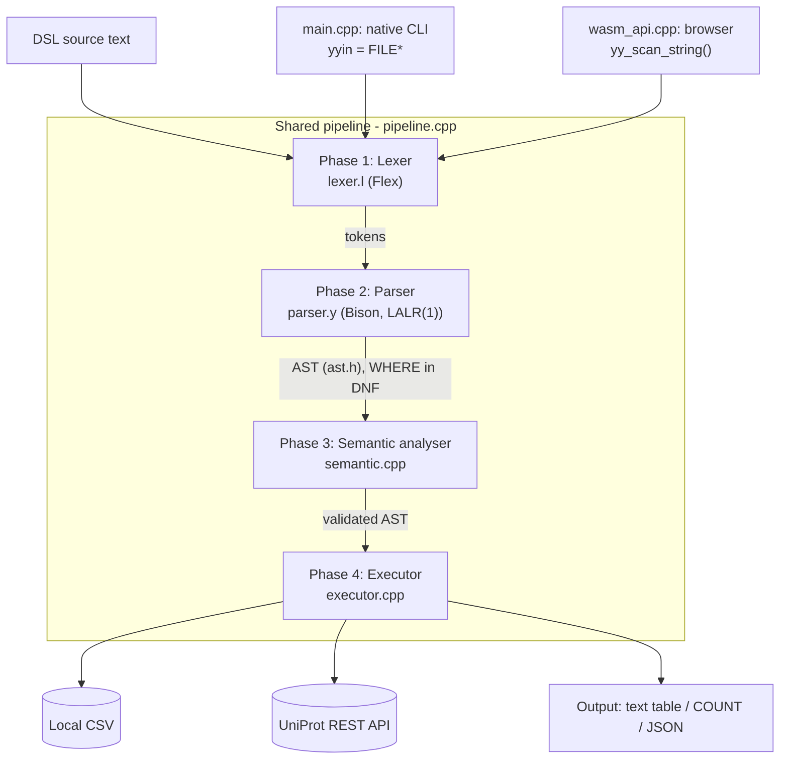

# ProteinDSL: Design and Implementation of a Compiled Domain-Specific Query Language for Protein Databases, Targeting Both Native and WebAssembly Execution

**Author:** Akhil Teja (GitHub: `AkhilTeja2209`)
**Project repository:** `AkhilTeja2209/DSL-for-protein-database-query`
**Live artefact:** <https://akhilteja2209.github.io/DSL-for-protein-database-query/>
**Document type:** Technical report on the repository at commit `a3662e0`.
Sections 1–8 describe and evaluate that commit; §9 records the fixes made
afterwards in response to the review.

---

## Abstract

Researchers who query protein databases usually have two choices: web search
forms, which cannot express compound conditions, and SQL, which requires a
relational schema that has nothing to do with biology. This report presents
**ProteinDSL**, a small declarative query language that uses the vocabulary of
the domain (`FIND proteins WHERE organism = "Human" AND length > 300`). It is
implemented as a classical four-phase compiler: lexical analysis (Flex), LALR(1)
syntax analysis (Bison), semantic analysis, and query execution. One C++17 core
is compiled twice. The first build is a native command-line tool. The second is
a WebAssembly module that runs the whole compiler inside a static web page, with
no server. Programs can query a local CSV file or a live search of the UniProt
Knowledgebase over its REST API. In the browser this is done by suspending the
WebAssembly stack across a JavaScript `fetch()` with Emscripten's ASYNCIFY.

The grammar has 34 productions over 23 terminals. Bison builds it into a
50-state LALR(1) automaton with no conflicts. A `WHERE` clause is built directly
into disjunctive normal form while the parser reduces it, so evaluation needs no
tree walk. Each literal carries a type tag taken from the token that produced
it, which lets the semantic phase reject type errors in both directions.

We tested the system on the bundled sample programs, a battery of 16 edge-case
programs, and synthetic datasets of 10³ to 10⁶ records. Every run produced the
documented output and exit code. The front end handled a 2.47 MB program of
20,001 statements in 0.39 s. Execution scales linearly for filtering: 1 M
records were loaded and counted in 2.8 s. Run time is dominated by CSV loading,
except for case-insensitive string sorts, which take up to 8.5 s at 1 M records.

The evaluation also found six defects or gaps, none of which affects the
documented sample programs:

- non-integer `TOP` values are silently truncated;
- an out-of-range `TOP` overflows into a misleading error message;
- `curl` failures report a raw wait status instead of an exit code;
- the parser leaks memory on syntax errors;
- syntax error messages are generic;
- there is no automated test suite.

We describe each one and propose a fix. §9 reports the fixes as made and
re-measured.

**Keywords:** domain-specific languages, compiler construction, Flex, Bison,
LALR(1), semantic analysis, bioinformatics, UniProt, WebAssembly, Emscripten.

---

## 1. Introduction

### 1.1 Motivation

Protein knowledgebases such as UniProtKB [1] hold hundreds of millions of
sequence records and their annotations. A biologist usually asks them simple
but compound questions:

- *"Which human proteins longer than 300 residues are transporters?"*
- *"Which entries contain the motif `MVLSPADK`?"*
- *"List the ten longest reviewed human kinases."*

The common ways of asking these questions each have a cost:

| Interface | Strength | Weakness |
|-----------|----------|----------|
| Web search forms | No learning curve | Cannot express arbitrary AND/OR combinations; results are not reproducible scripts |
| Database-specific query syntax (e.g. UniProt's Lucene-style query language) | Expressive over the server's index | Each database has its own syntax; no local post-processing |
| SQL over a local copy [9] | Fully expressive | The user must design or learn a relational schema and install a DBMS |
| General-purpose scripting (e.g. Biopython [8]) | Unlimited | It is programming, not querying; high barrier for non-programmers |

A **domain-specific language (DSL)** sits between these. It gives up generality
in exchange for notation that matches the domain [3, 4, 5].

### 1.2 Objective

The project behind this report had two goals. The first was educational: build a
complete compiler that shows all the classical phases [2] working on a problem
from outside computer science. The second was practical: make the result usable
by people with nothing installed. The repository's own README states the
priority: *"The point of the project is the compiler, not the database."*

### 1.3 Contributions

This report documents and evaluates the following:

1. **A query language** for protein records, with a formal, conflict-free
   LALR(1) grammar, a static type discipline, and a defined execution order
   (§3).
2. **A four-phase compiler** in about 1,700 lines of C++17, Flex and Bison. Each
   phase can be inspected on its own, and failures are reported per phase with
   distinct process exit codes (§4).
3. **Two data back ends** behind one statement: a local RFC 4180 CSV reader, and
   a live UniProt REST client with response caching (§4.6).
4. **One compiler core with two targets.** The same pipeline is compiled to a
   native CLI and to a WebAssembly module hosted as a static site on GitHub
   Pages. The two builds differ in only three guarded places (§4.8).
5. **An empirical evaluation** of correctness, error handling, scalability and
   memory use, plus a code review that finds concrete defects and proposes
   fixes for them (§5, §6).

### 1.4 Organisation

- §2 covers background and related work.
- §3 defines the language.
- §4 describes the architecture and implementation.
- §5 presents the evaluation.
- §6 discusses design decisions, limitations and threats to validity.
- §7 outlines future work, and §8 concludes.
- Appendices give the full grammar, the error catalogue and the steps to
  reproduce the results.

---

## 2. Background and Related Work

### 2.1 Compiler construction

The classical compiler pipeline has these phases [2]:

1. Lexical analysis, using regular expressions compiled to a DFA.
2. Syntax analysis, using a context-free grammar.
3. Semantic analysis.
4. Code generation or interpretation.

LR parsing was introduced by Knuth [10]. The LALR(1) refinement by DeRemer [11]
keeps LR(1)'s power for practical grammars while producing much smaller tables.
That is the algorithm GNU Bison uses by default. Flex and Bison [6] generate the
lexer and parser from declarative specifications, which is why they remain
standard in teaching and in production front ends.

### 2.2 Domain-specific languages

Mernik et al. [3] list the reasons to build a DSL: domain-specific notation,
analysis and checking at the level of the domain, and better productivity for
domain experts. They also list the ways to implement one: an interpreter, a
compiler, or embedding in a host language. Fowler [4] separates *external* DSLs,
which have their own syntax and parser, from *internal* DSLs, which are embedded
in a host language. Van Deursen et al. [5] survey early DSLs and stress that a
DSL should be small. ProteinDSL is an **external DSL implemented as a compiler
with an interpreting back end**. The front end is a real compiler, and the
"code generation" phase is replaced by direct execution of the checked AST.

### 2.3 Query languages for biological data

SQL [9] and the relational model behind it [12] are the general-purpose
baseline. In bioinformatics there are several more specialised options:

- **Database-native query syntaxes.** UniProt's REST search accepts field-scoped
  boolean queries such as `organism_id:9606 AND reviewed:true` [1].
- **Federated query systems.** BioMart [13] presents biological databases
  through a uniform filter-and-attribute model.
- **Programmatic toolkits.** Biopython [8] wraps database access in a
  general-purpose language.
- **Similarity search.** Tools such as BLAST [14] answer a different question
  (homology) from substring motif search.

ProteinDSL does not try to replace any of these. It *composes* with UniProt.
Retrieval is delegated to UniProt's own query language inside
`LOAD UNIPROT "..."`. ProteinDSL then adds local filtering, sorting, projection
and counting with static checks on top of whatever was retrieved.

### 2.4 Compiling to the browser

WebAssembly [15] is a portable, sandboxed bytecode that runs at near-native
speed in every major browser. Emscripten [16] compiles C and C++ to WebAssembly
and provides a POSIX-like runtime, including a virtual filesystem. Its
**ASYNCIFY** transformation instruments the compiled code so that a synchronous
C++ call stack can be suspended while the browser runs an asynchronous operation,
and resumed afterwards. ProteinDSL uses this to keep a blocking-style executor
while performing non-blocking network I/O in the browser (§4.8).

---

## 3. Language Design

### 3.1 Data model

There is one queryable entity, `proteins`. Each record has six attributes
(`semantic.cpp: proteinFields()`):

| Attribute | Type | Description |
|-----------|------|-------------|
| `proteinid` | string | Accession (e.g. `P01308`) |
| `name` | string | Protein name |
| `organism` | string | Source organism |
| `length` | **number** | Residue count; the only numeric attribute |
| `function` | string | Free-text functional annotation |
| `sequence` | string | Amino-acid sequence |

Attribute names are **case-insensitive**. Keywords are **uppercase only**, so
`find` lexes as an identifier.

### 3.2 Lexical structure

The lexer (`lexer.l`, 72 lines) recognises these token classes:

- **14 keywords:** `LOAD UNIPROT FIND WHERE AND OR SEARCH SORT BY ASC DESC TOP
  DISPLAY COUNT`
- **6 comparison operators:** the two-character forms `>= <= !=` come first,
  followed by `= > <`
- **Identifiers:** `[A-Za-z_][A-Za-z0-9_]*`
- **Strings:** `"[^"]*"`, with no escape sequences
- **Numbers:** `[0-9]+(\.[0-9]+)?`
- **`//` line comments**
- **Insignificant whitespace**, including newlines

Keyword rules are placed before the identifier rule. Flex prefers the longest
match and breaks ties by rule order, so `LOAD` becomes a keyword while
`loaded_at` stays an identifier. Any other character produces a lexical error
that reports its line. The lexer records the error and keeps going, so one run
can report several lexical errors.

### 3.3 Syntax

The full grammar is in Appendix A. In outline:

```
statement ::= "LOAD" string
            | "LOAD" "UNIPROT" string top_opt
            | "FIND" identifier search_opt where_opt sort_opt top_opt output_opt
```

Each optional clause of `FIND` starts with its own keyword (`SEARCH`, `WHERE`,
`SORT BY`, `TOP`, `DISPLAY`/`COUNT`), and the clauses must appear in a fixed
order. Because of this, Bison builds the grammar with **zero shift/reduce and
zero reduce/reduce conflicts**, which we verified with `bison -Wall` and the
state report (§5.1).

Boolean precedence is encoded structurally, without `%left` declarations:

```
or_expr  ::= and_expr | or_expr "OR" and_expr
and_expr ::= condition | and_expr "AND" condition
```

`AND` therefore binds tighter than `OR`. Parentheses are not supported.

### 3.4 Static semantics

The semantic analyser (`semantic.cpp`) enforces these rules, and reports
**every** violation it finds rather than stopping at the first:

| # | Rule |
|---|------|
| S1 | A `FIND` must be preceded by some `LOAD` (definite-assignment check on the implicit dataset). |
| S2 | The entity must be `proteins` (case-insensitive). |
| S3 | Every attribute in `WHERE`, `SORT BY` and `DISPLAY` must be one of the six known attributes. |
| S4 | The ordering operators `> < >= <=` apply only to the numeric attribute. |
| S5 | **Two-way literal typing:** a numeric attribute requires a `NUMBER` token, and a string attribute requires a `STRING` token. |
| S6 | `TOP n` must be positive. |
| S7 | `LOAD UNIPROT` must have a non-empty query and `1 ≤ TOP ≤ 500` (the API's page cap). |
| S8 | `LOAD` must have a non-empty file path. |

Rule S5 depends on a deliberate design choice. The parser stores *which token
the lexer produced* (`ValueLiteral::isNumeric`) instead of guessing the type
from the literal's text later. As a result, `length = "300"` is rejected rather
than being coerced and silently accepted.

### 3.5 Dynamic semantics

Each `LOAD` **replaces** the current dataset. Each `FIND` is evaluated against
the current dataset as a fixed pipeline:

$$
\textsf{result} = \pi_{\textsf{cols}}\Big(\tau_{n}\big(\sigma_{\textsf{key},\textsf{dir}}(\{\,r \in D \mid \textsf{search}(r) \wedge \textsf{where}(r)\,\})\big)\Big)
$$

- **Filter** keeps a record only if it passes both `SEARCH` and `WHERE`.
- **Sort** is `std::stable_sort`. The comparison is numeric for `length` and
  case-insensitive lexicographic for all other attributes.
- **Truncate** (τ) keeps the first *n* results.
- **Project** (π) keeps the `DISPLAY` columns in the order given, or all six
  columns. `COUNT` reports |τ(…)| instead of rows.

The matching rules are:

- `SEARCH t` is a case-insensitive substring test across all six attributes,
  including `sequence`. It therefore also works as a naive motif search.
- On strings, `=` and `!=` are **case-insensitive exact** matches, not substring
  matches. This matters for UniProt data, where organisms appear as
  `Homo sapiens (Human)`.

### 3.6 Example programs

```
LOAD "dataset/proteins.csv"
FIND proteins
WHERE organism = "Human" AND length > 500
   OR organism = "Chicken"
SORT BY length DESC
DISPLAY proteinid name organism length

FIND proteins SEARCH "MVLSPADK" DISPLAY name length
FIND proteins WHERE organism = "Human" COUNT
```

```
LOAD UNIPROT "kinase AND organism_id:9606 AND reviewed:true" TOP 100
FIND proteins WHERE length > 800 SORT BY length DESC TOP 10
DISPLAY proteinid name length function
```

---

## 4. System Architecture and Implementation

### 4.1 Overview



The codebase is split by phase. Line counts are for hand-written source only:

| Component | File(s) | LoC | Role |
|-----------|---------|----:|------|
| Lexer | `lexer.l` | 72 | Tokenisation, lexical errors |
| Parser | `parser.y` | 264 | Grammar, AST construction, syntax errors |
| AST | `ast.h`, `ast.cpp` | 185 | IR types, pretty-printer |
| Semantic analysis | `semantic.h`, `semantic.cpp` | 160 | Rules S1–S8, shared attribute catalogue |
| Executor | `executor.h`, `executor.cpp` | 622 | CSV/UniProt loading, evaluation, rendering |
| Pipeline | `pipeline.h`, `pipeline.cpp` | 254 | Phase sequencing, JSON serialisation, exit codes |
| Native front end | `main.cpp` | 102 | CLI arguments, file/stdin input |
| WebAssembly front end | `wasm_api.cpp` | 53 | String input, exported C ABI |
| Web UI | `web/*` | 347 | Editor, examples, result tables, AST view |
| Build and CI | `Makefile`, `pages.yml`, `make_examples.py` | 227 | Native and wasm builds, deployment |

### 4.2 Phase 1: lexical analysis

Flex is built with `%option yylineno` so that every diagnostic can report a line
number. Its two diagnostic paths behave as follows:

- **Unrecognised character.** The error is appended to a global
  `g_parseErrors` list and also printed to `stderr`. This way the human-readable
  report and the JSON output both carry the same message.
- **String and identifier lexemes.** These are passed to Bison through
  `yylval.strval` as `strdup`'d C strings. The Bison actions copy them into
  `std::string` and then `free` them.

### 4.3 Phase 2: syntax analysis and AST construction

The `%union` holds owned pointers to partial AST fragments (`Condition*`,
`AndGroup*`, `WhereClause*`, `SortSpec*`, `OutputSpec*`, `ValueLiteral*`),
plus scalar enums for operators and sort direction.

**Building DNF during reduction.** `WhereClause` is a
`std::vector<std::vector<Condition>>`, an OR of AND-groups:

- Reducing `and_expr AND condition` appends to the current group.
- Reducing `or_expr OR and_expr` starts a new group.

The parser therefore produces the final evaluation form directly, with no
separate normalisation pass. The DNF is exact rather than an expansion, because
the language has no parentheses and so no nested sub-expressions.

**Sentinel encoding of optional clauses.** Absent clauses are encoded as
`nullptr`, or as `kNoTop = -1.0` for `TOP`. That sentinel is safe because the
lexer has no negative literals.

**Number formatting.** `NUMBER` literals are kept as `double`. Integral values
are printed without a fractional part, so `300` appears as `300` and not
`300.000000` in the AST dump.

**Flat `Statement` record.** The AST deliberately uses one flat `Statement`
struct tagged by `StmtType`, rather than a class hierarchy with visitors. For a
language with two statement forms, this keeps both the printer and the analyser
to a single loop.

### 4.4 Phase 3: semantic analysis

`validateProgram()` makes a single forward pass. It tracks a boolean `seenLoad`
for rule S1, and checks each `FIND`'s conditions, sort key, `TOP` and display
list against the attribute catalogue.

The executor uses the same catalogue (`proteinFields()`, `isNumericField()`),
so the checker and the evaluator cannot disagree about which attributes exist.
An unknown attribute skips its type checks (`continue`), which avoids cascading
errors. All errors are collected and reported together.

### 4.5 Phase 4: execution

`runQuery()` carries out the pipeline from §3.5 over a vector of
`const ProteinRecord*`, so no record is copied before projection.

`matchWhere()` uses two nested loops that short-circuit:

- It returns true as soon as one AND-group fully matches.
- Within a group, it abandons the group at the first condition that fails.

`COUNT` never materialises rows. The text renderer shortens cells to 40
characters so long sequences do not break the table. The JSON output always
carries the full values.

### 4.6 Data back ends

**CSV.** `loadDataset()` expects a header row followed by six fields per row,
parsed with RFC 4180 quoting [17] (`"a,b"`, with `""` for an embedded quote).
It fails with a runtime error if a row has fewer than six fields or a
non-integer `Length`. Each error message includes the line number.

**UniProt.** `loadUniProt()` sends this request to the UniProtKB search
endpoint:

```
https://rest.uniprot.org/uniprotkb/search?query=<enc>
  &fields=accession,protein_name,organism_name,length,cc_function,sequence
  &format=tsv&size=<n>
```

**Query encoding and shell safety.** The query is percent-encoded over
everything outside the RFC 3986 unreserved set [18]. The native build invokes
the system `curl` through `std::system`, so this encoding is also what stops a
hostile query string from becoming shell syntax. The DSL's strings cannot
contain `"` in any case.

**Atomic caching.** Responses are cached under `.cache/uniprot-<FNV-1a(url)>.tsv`.
The download goes to a `.part` file first and is then renamed, so an
interrupted download never leaves a corrupt cache entry. A cached response that
turns out to contain no entries is deleted, so a transient failure cannot become
permanent.

**Annotation cleaning.** In the `function` column, the `FUNCTION: ` prefix and
`{ECO:…}` evidence tags are stripped with a depth-counting scan, and the
remaining whitespace is collapsed.

### 4.7 Pipeline, diagnostics and exit codes

`runPipeline()` runs the phases in order and stops at the first phase that
fails. It returns a `PipelineOutput` with:

- `ok`;
- `stage` (one of `parse`, `semantic`, `runtime`, `done`);
- the AST text;
- the errors;
- the sources loaded;
- the results.

That structure is serialised to JSON by a hand-written emitter with full string
escaping, including `\u00XX` for control characters. The CLI maps each stage to
an exit code: **0** success, **1** usage/IO, **2** lexical or syntax error,
**3** semantic error, **4** runtime error. A calling script can therefore tell a
typo apart from an unreachable network without parsing the text output.

### 4.8 Two targets from one core

Both front ends do three things:

1. Call `resetPipelineState()`.
2. Point Flex at their input: `yyin = FILE*` natively, or `yy_scan_string()` in
   the browser.
3. Call the same `runPipeline()`.

The WebAssembly build exports one C function, `proteindsl_run_json`, which
JavaScript calls with `ccall(..., {async: true})`. The two builds differ in
exactly three places, all behind `#ifdef __EMSCRIPTEN__`:

1. **Networking.** `EM_ASYNC_JS` defines `js_fetch_text()`, which `await`s
   `fetch()`. ASYNCIFY suspends the WebAssembly stack around the call, so
   `loadUniProt()` keeps its synchronous shape. UniProt sends
   `Access-Control-Allow-Origin: *`, so no proxy is needed.
2. **Caching.** Responses are kept in an in-memory `std::map` for the life of
   the tab, instead of in an on-disk cache.
3. **Files.** `dataset/` is preloaded into Emscripten's virtual filesystem with
   `--preload-file`, so `LOAD "dataset/proteins.csv"` behaves the same in both
   builds.

The web page renders results with `textContent` and never with `innerHTML`, so
text arriving from UniProt cannot inject markup. The list of examples on the
page is generated at build time from `sample_queries/` by
`tools/make_examples.py`, so the page and the samples cannot drift apart.

### 4.9 Build, continuous integration and deployment

The `Makefile` builds `bin/proteindsl` with `g++ -std=c++17 -Wall -Wextra`, and
builds `docs/` with `em++` using these flags:

```
-O2 -sASYNCIFY -sMODULARIZE -sALLOW_MEMORY_GROWTH
```

The GitHub Actions workflow (`pages.yml`) runs on every push to `main` that
touches source, data, samples or the web UI. It does the following:

1. Installs Flex and Bison.
2. Restores a cached, version-pinned Emscripten SDK (6.0.9).
3. Runs `make wasm` and checks that the three build outputs exist and are
   non-empty.
4. Builds the native CLI and checks that the documented sample still produces
   the `Hemoglobin` row.
5. Deploys `docs/` to GitHub Pages.

No build artefact is committed: `docs/`, `build/` and `bin/` are all in
`.gitignore`.

### 4.10 Development history

The commit log shows the project developing in three stages:

1. **Initial specification (28 Aug 2026).** Lexer, grammar and sample queries
   were uploaded.
2. **Implementation (3 Sep 2026).** Full execution and the UniProt connection
   were added, followed by the web playground, the WebAssembly build, and
   CI-built Pages deployment.
3. **Consolidation (4 Sep 2026).** The earlier Python server was removed in
   favour of the fully client-side WebAssembly build, syntax errors were
   surfaced in JSON, and the documentation was finalised.

Removing the server is the most significant architectural decision in the
history. It traded a running service for a static, zero-cost, zero-maintenance
deployment.

---

## 5. Evaluation

All measurements used this environment:

- **Machine:** 4-vCPU Intel Xeon at 2.10 GHz, Ubuntu 24.04.
- **Toolchain:** g++ 13.3, GNU Bison 3.8.2, Flex 2.6.4.
- **Build:** the repository's own `make`, with no optimisation flag set (the
  `Makefile` does not pass `-O`). The figures are therefore conservative for the
  native binary.
- **Timing:** wall-clock time for the complete process (start, lex, parse,
  analyse, load, execute, serialise to JSON), taking the best of three runs.

### 5.1 Grammar properties

| Property | Value |
|----------|------:|
| Terminals (14 keywords + 6 operators + 3 lexeme classes) | 23 |
| Non-terminals | 14 |
| Productions (excluding `$accept`) | 34 |
| LALR(1) states | 50 |
| Shift/reduce conflicts | **0** |
| Reduce/reduce conflicts | **0** |

The build is warning-free apart from one warning in Flex-generated code
(`yyunput` defined but unused). That warning could be removed with
`%option nounput`.

### 5.2 Functional correctness

**Sample programs.** All bundled samples produced exactly the output the README
documents:

| Program | Expected | Observed | Exit |
|---------|----------|----------|:----:|
| `valid_query.dsl` | Hemoglobin (574) and Albumin (609) | as expected | 0 |
| `advanced_query.dsl` | OR/SORT: Albumin, Hemoglobin, Lysozyme; SEARCH: Hemoglobin; COUNT = 3 | as expected | 0 |
| `invalid_query.dsl` | 3 semantic errors | as expected (all 3 reported) | 3 |
| `uniprot_query.dsl` | 10 longest human kinases | **not reproduced here**: outbound access to `rest.uniprot.org` was blocked by the evaluation sandbox (HTTP 403); runtime error reported correctly | 4 |

**Edge-case battery.** We ran 16 more programs through `--json`:

| # | Program fragment | Stage / exit | Result | Verdict |
|---|------------------|--------------|--------|---------|
| 1 | `WHERE organism = "human" COUNT` | done / 0 | 3 (case-insensitive) | ✔ |
| 2 | `WHERE Length >= 147 AND LENGTH <= 574 SORT BY name` | done / 0 | Hemoglobin, Lysozyme | ✔ (case-insensitive attributes, alphabetical sort) |
| 3 | `WHERE length = 1273.0` | done / 0 | Spike | ✔ |
| 4 | `TOP 2.7` | done / 0 | 2 rows | ⚠ silently truncated (§6.3, D1) |
| 5 | `SEARCH ""` | done / 0 | 5 | ✔ (empty string matches everything) |
| 6 | `SORT BY organism DESC TOP 2` | done / 0 | SARS-CoV-2, Human | ✔ |
| 7 | stray `@` | parse / 2 | lexical error, line 2 | ✔ |
| 8 | `WHERE length > COUNT` | parse / 2 | syntax error, line 2 | ✔ (message generic, D5) |
| 9 | lowercase `find proteins` | parse / 2 | syntax error, line 1 | ✔ (by design) |
| 10 | `FIND genes WHERE length = "300" TOP 0 DISPLAY foo` (no LOAD) | semantic / 3 | **5** errors in one pass | ✔ |
| 11 | `LOAD UNIPROT "" TOP 501` | semantic / 3 | 2 errors | ✔ |
| 12 | `LOAD "nope.csv"` | runtime / 4 | could not open | ✔ |
| 13 | `WHERE (length > 3)` | parse / 2 | 2 lexical errors | ✔ (no parentheses) |
| 14 | `COUNT DISPLAY name` | parse / 2 | syntax error | ✔ (mutually exclusive) |
| 15 | unterminated string `"abc` | parse / 2 | lexical and syntax error | ✔ |
| 16 | empty program | done / 0 | no output | ✔ |

On top of these, `TOP 99999999999999999999` produced
`TOP must be a positive integer, got -9223372036854775808` (§6.3, D2).

Of the 20 programs run in total (4 samples and 16 edge cases):

- 18 behaved exactly as documented;
- 1 (the UniProt sample) could not be checked in this environment;
- 1 (#4) exposed a missing validation.

Case #10 shows the advantage of collecting every semantic error in one pass: a
single run reported all five independent problems.

### 5.3 Performance and scalability

**Datasets.** We generated synthetic CSVs with a fixed seed (42). Each record
has a random organism (6 values), a random length (50–2000), a function (6
values) and a 60-residue random sequence. The file sizes were:

| Records | CSV size |
|--------:|---------:|
| 10³ | 0.1 MB |
| 10⁴ | 1.07 MB |
| 10⁵ | 10.8 MB |
| 10⁶ | 108.5 MB |

**Queries.** Each row of the timing table below is one query:

- **Q0** `LOAD` only.
- **Q1** `FIND proteins COUNT`.
- **Q2** `WHERE organism = "Human" AND length > 500 OR organism = "Yeast" COUNT`
  (two AND-groups).
- **Q3** `SEARCH "KLMN" COUNT` (a substring scan over every attribute).
- **Q4** `WHERE length > 1000 SORT BY length DESC TOP 10 DISPLAY …` (numeric
  sort).
- **Q5** `SORT BY name TOP 10 DISPLAY name` (case-insensitive string sort over
  every record).

Timings are wall-clock seconds, best of three runs:

| Query | 10³ | 10⁴ | 10⁵ | 10⁶ |
|-------|----:|----:|----:|----:|
| Q0 `LOAD` only | 0.008 | 0.030 | 0.256 | 2.75 |
| Q1 `COUNT` | 0.007 | 0.033 | 0.335 | 2.81 |
| Q2 two-group DNF `WHERE` | 0.008 | 0.042 | 0.382 | 3.87 |
| Q3 `SEARCH` substring | 0.010 | 0.059 | 0.488 | 5.01 |
| Q4 numeric `WHERE` + `SORT` + `TOP` | 0.008 | 0.041 | 0.333 | 3.73 |
| Q5 string `SORT` + `TOP` | 0.011 | 0.068 | 0.782 | 8.46 |

**Observations.**

1. **Loading dominates.** Q0 accounts for about 98 % of Q1's time at 10⁶
   records. Filtering itself is cheap. Loading scales linearly at about 2.7 µs
   per record, or about 25 ns per byte.
2. **Filtering is linear.** Q2 adds about 1.1 µs per record over Q0. Q3 adds
   about 2.3 µs, because `SEARCH` lowercases and scans all six attributes,
   including the sequence, for every record.
3. **The string sort is the slowest operation.** Q5 is about 3× Q0 at 10⁶ and
   grows as *n* log *n*. The comparator calls `toLower(fieldValue(...))` on both
   operands on every comparison. That is about 2·*n* log₂ *n* ≈ 4×10⁷ heap
   allocations at 10⁶ records. Lowercasing the keys once before sorting
   (decorate–sort–undecorate) would remove them. The numeric sort (Q4) has no
   such cost.
4. **The front end is fast.** A program of 20,001 statements (2.47 MB), each
   with a two-group `WHERE`, `SORT`, `TOP` and `DISPLAY`, was lexed, parsed,
   analysed and executed against the 5-record dataset in **0.39 s**. That is
   about 6.3 MB/s end to end. For realistic program sizes, compilation time is
   negligible.
5. **Memory.** Peak resident set size at 10⁵ records (a 10.8 MB file) was
   **30.6 MB**. That is roughly 2.8× the file size, mostly per-field
   `std::string` overhead.

For interactive use (UniProt result sets of at most 500 records, or curated
local files of up to about 10⁵ records), every query finishes well under one
second.

### 5.4 Portability

CI builds both targets from the same sources on every push. The native build
needs only Flex, Bison, a C++17 compiler and, for `LOAD UNIPROT`, `curl`. `curl`
ships with Windows 10 and later and with mainstream Linux distributions, so the
binary itself has no third-party library dependency.

---

## 6. Discussion

### 6.1 Assessment of the design decisions

**DNF as the intermediate representation.** Building the `WHERE` clause in DNF
during reduction removes both the expression tree and the evaluator that would
walk it. This works because the grammar has no parentheses. If parentheses are
added (§7), DNF would have to be computed by distribution, which can grow
exponentially. A small boolean expression tree would then be the better
representation.

**Type tags from tokens.** This is the cheapest correct way to type literals in
a language with only two types, and it catches errors in both directions. The
same idea would carry over to a richer type system, such as dates or
enumerations.

**`curl` instead of libcurl.** This keeps the build free of dependencies. It
does make the native build depend on an external process, and it makes the
URL-encoding function security-critical. That is acceptable only because the
encoding is strict (an allow-list rather than a deny-list) and the language
forbids `"` in strings.

**Two front ends over one pipeline.** By construction, the CLI and the browser
give the same answers for the same programs. The only difference in data access
is the documented, guarded I/O layer. This is a cleaner arrangement than the
earlier client–server version it replaced.

**Global parser state.** Bison and Flex in their default (non-reentrant) mode
keep state in globals (`g_program`, `g_parseErrors`, `yylineno`, `lex_errors`).
`resetPipelineState()` makes repeated runs in the WebAssembly module safe, but
the core cannot run two programs at once. That is fine for a CLI or a
single-threaded browser tab.

### 6.2 Limitations of the language

The README states these limitations, and the evaluation confirms them:

- **Expressions.** There are no parentheses, so precedence is fixed. There are
  no `NOT`, `IN`, `LIKE` or range operators.
- **Types.** Only `length` is numeric. String equality is exact (though
  case-insensitive), so matching on UniProt organism names requires `SEARCH` or
  filtering on the server side.
- **Datasets.** Only one dataset is in scope at a time. There are no joins,
  aggregates beyond `COUNT`, or grouping.
- **Strings.** String literals have no escape sequences.
- **UniProt.** One page of at most 500 entries per load, with no pagination.
  The native cache never expires.
- **Syntax.** Keywords must be uppercase.

### 6.3 Defects found during review

The evaluation and a code review found these issues. None affects the
documented sample programs.

| ID | Location | Issue | Impact | Suggested fix |
|----|----------|-------|--------|---------------|
| D1 | `parser.y` (`top_opt`), `semantic.cpp` | `TOP` takes a `NUMBER`, which may be fractional. `TOP 2.7` is truncated to 2 without a diagnostic. | Low; a confusing result | Record `isNumeric`/integral-ness like conditions do, and add a semantic rule that `TOP` must be an integer |
| D2 | `parser.y` | The `double`→`long` conversion for a huge `TOP` is out of range, which is undefined behaviour in C++. In practice it yields `got -9223372036854775808`. | Low; a misleading message | Range-check before the cast, or keep `TOP` as `double` until semantic analysis |
| D3 | `executor.cpp` (`loadUniProt`) | `std::system()` returns a wait status, not an exit code. A curl HTTP failure (exit 22) is reported as `curl exit code 5632` (= 22 « 8). | Low; misleading diagnostics | Use `WEXITSTATUS(rc)` on POSIX |
| D4 | `parser.y` | No `%destructor` declarations, so `strdup`'d strings and heap AST fragments on the parser stack are leaked when Bison discards them after a syntax error. In the long-lived WebAssembly module, the leak grows with each failing run. | Low; a bounded leak per error | Add `%destructor { free($$); } <strval>` and `{ delete $$; }` for pointer types |
| D5 | `parser.y` | Syntax errors read only `syntax error`. Bison's verbose mode is not enabled, so the expected tokens are not listed. A lowercase keyword gives no hint. | Medium for usability | `%define parse.error detailed` (Bison ≥ 3.6), plus `%locations` for column numbers |
| D6 | repository | No automated test suite. CI checks one substring of one sample's output. | Medium for maintenance | Golden-file tests: run each `.dsl` with `--json` and diff against an expected file, covering the 16 cases in §5.2 |

There is also a minor inaccuracy in the documentation. The playground's
reference panel says *"File access is confined to `dataset/`"*. That is true of
the browser build, because only `dataset/` is preloaded into the virtual
filesystem. The native CLI reads any path it is given.

### 6.4 Threats to validity

- **Synthetic data.** The benchmark data has short (60-residue) sequences and
  few distinct values. Real UniProt sequences average about 350 residues, which
  would increase both `SEARCH` cost and memory per record.
- **Unoptimised build.** Timings come from the repository's default build,
  which passes no `-O` flag. An `-O2` native build would be faster. The
  WebAssembly build uses `-O2` but was not benchmarked.
- **UniProt not tested here.** The UniProt path could not be exercised in the
  evaluation environment. Its correctness is argued from the code and the README
  rather than observed.
- **Single machine.** All timings come from one machine and are best-of-three
  wall-clock times. Measurements of a few milliseconds are close to the noise
  floor of process start-up.

---

## 7. Future Work

1. **Richer boolean expressions.** Add parentheses and `NOT`, and replace DNF
   with a small expression tree. This is straightforward in the existing LALR(1)
   framework using explicit precedence levels.
2. **Partial string matching** in `WHERE`, such as `organism CONTAINS "Human"` or
   `LIKE`. This would make UniProt organism names usable without `SEARCH`.
3. **Better diagnostics.** Fix D5 by naming expected tokens and adding column
   numbers. Suggest the uppercase keyword when a lowercase identifier matches
   one.
4. **Aggregates and grouping.** For example, `COUNT BY organism` and
   `AVG length`.
5. **More data sources.** UniProt pagination beyond 500 entries using
   cursor-based `Link` headers; FASTA input; PDB and NCBI back ends behind the
   same `LOAD` statement.
6. **Performance.** Precompute lowercase keys for sorting and searching, and
   stream CSV parsing to reduce memory use.
7. **Testing.** Add golden-file and property-based tests (for example, checking
   that DNF evaluation matches a reference boolean evaluator on random
   conditions), run under AddressSanitizer in CI to guard against D4-type
   regressions.
8. **Editor support.** Syntax highlighting and inline diagnostics in the
   playground, using the existing JSON error output.

---

## 8. Conclusion

ProteinDSL shows that a teaching-scale compiler can also be a usable tool.
In about 1,700 lines of hand-written code it implements:

- a formally specified, conflict-free LALR(1) language;
- a static checker that rejects meaningless queries before any data is touched;
- an executor that handles both local files and a live, authoritative protein
  knowledgebase.

Two engineering choices give it much of its value:

- **Building the `WHERE` clause in disjunctive normal form during parsing**
  removes an entire evaluation layer.
- **Compiling one pipeline to both native code and WebAssembly** turns a
  command-line compiler into a zero-installation web application without
  forking the code.

The evaluation confirms the documented behaviour on all samples that could be
run in our environment, linear scaling for filtering, and acceptable interactive
latency. It also identifies six concrete, low-risk improvements. All of them are
local fixes that do not require architectural change.

---

## 9. Addendum: Fixes Applied After the Review

Every defect in §6.3, the documentation inaccuracy, and the performance
problem in §5.3 have since been fixed. Each fix was checked with the test suite
described under D6, which also runs under AddressSanitizer and
UndefinedBehaviorSanitizer.

| ID | Fix | Verified by |
|----|-----|-------------|
| D1 | The AST keeps the `TOP` literal as written (`topLiteral`, `uniprotLimitLiteral`). Semantic analysis rejects fractions: `TOP must be a whole number, got 2.7`. | `top_fractional`, `uniprot_top_fractional` |
| D2 | The parser converts a `TOP` literal to a count only when it lies in [1, 2³¹−1], so the out-of-range conversion can no longer happen. The error now reads `TOP must be at most 2147483647, got 100000000000000000000`. | `top_out_of_range` |
| D3 | The `std::system()` result is decoded with `WEXITSTATUS` (taken as is on Windows). curl also writes the HTTP status and the proxy's CONNECT status to a side file, so each cause gets its own message (see below). | Manual run against the blocked proxy |
| D4 | `%destructor`s for every heap-allocated semantic value. On the original code, LeakSanitizer reported 3 leaks for `FIND proteins WHERE name = "a" AND length >`; after the fix it reports none. | `make test-asan` |
| D5 | `%define parse.error custom` with full LAC (`parse.lac full`) and a reporter that lists every expected token, plus a hint for lowercase keywords. See the examples below. | `syntax_error_*`, `lowercase_*`, `count_display_exclusive` |
| D6 | `tests/run_tests.py` and `make test`: 37 golden-file tests (33 cases and the 4 samples), each comparing the JSON document and the exit code. `make test-asan` runs the same suite on a sanitizer build, and CI runs both before deploying. | CI |
| Doc | The playground reference now says that in the browser only the bundled `dataset/` files exist. | n/a |
| §5.3 | String sort keys are lower-cased once per record rather than on every comparison, and the `SEARCH` term once per query rather than once per record. | Benchmark below |

D5 changes syntax errors like these:

| Input | Before | After |
|-------|--------|-------|
| `FIND proteins WHERE length > COUNT` | `syntax error` | `unexpected COUNT, expecting string or number` |
| `FIND proteins SORT length` | `syntax error` | `unexpected identifier, expecting BY` |
| `FIND proteins Where length > 3` | `syntax error` | `unexpected identifier, expecting end of file, LOAD, FIND, WHERE, COUNT, DISPLAY, SORT, TOP or SEARCH (keywords are uppercase: did you mean 'WHERE'?)` |

Without LAC, the third message would have listed only `end of file, LOAD or
FIND`. By the time the error is detected, LALR(1) default reductions have
already closed the optional clauses of `FIND`.

**The UniProt connection.** The failure in §5.2 came from the evaluation
sandbox's network policy, not from the code. Its proxy refused `CONNECT
rest.uniprot.org:443` with HTTP 403. The review found three real weaknesses on
this path, all now fixed:

1. **Misleading exit code.** It reported `curl exit code 5632` (D3).
2. **No cause given.** With `curl -f`, a proxy refusal surfaces as exit code 22,
   the same code as a UniProt HTTP error, so the message gave no way to tell a
   blocked network from a bad query. It now reads:
   `a proxy refused the connection to rest.uniprot.org (HTTP 403); the network
   policy may not allow that host`.
3. **No retries.** Transient failures were not retried. `--retry 2` now covers
   timeouts, HTTP 429 and 5xx.

Testing exposed one more cleanup problem. UniProt writes `... activity
{ECO:...}.`, and stripping the tag left a stray space before the full stop
(`activity .`). `cleanFunction()` now removes whitespace in front of
`. , ; : )`.

The UniProt parsing path, including the `FUNCTION:` prefix, evidence tags, CRLF
line endings, empty function columns, incomplete rows and the "no entries"
error, is now covered offline. The tests use synthetic cached responses in
`tests/fixtures/cache/`. A live request still needs network access to
`rest.uniprot.org`.

**Performance after the fixes.** These were measured as in §5.3, at 10⁶
records:

| Query | Before | After | Speed-up |
|-------|-------:|------:|---------:|
| Q1 `COUNT` (load-dominated, control) | 2.81 s | 2.80 s | — |
| Q3 `SEARCH` substring | 5.01 s | 4.69 s | 1.07× |
| Q5 string `SORT` + `TOP` | 8.46 s | 3.58 s | **2.36×** |

At 10⁵ records, Q5 fell from 0.78 s to 0.32 s.

The WebAssembly build was rebuilt with the CI-pinned Emscripten 6.0.9 and
exercised under Node.js. It gives the same results as the native build, and it
stayed correct across 200 consecutive failing parses in one module instance,
which is the situation where the D4 leak used to accumulate.

The items in §7 (Future Work) other than diagnostics, testing and the sort
performance remain open.

---

## References

[1] The UniProt Consortium. "UniProt: the Universal Protein Knowledgebase in
2023." *Nucleic Acids Research*, 51(D1):D523–D531, 2023.

[2] A. V. Aho, M. S. Lam, R. Sethi, J. D. Ullman. *Compilers: Principles,
Techniques, and Tools*, 2nd ed. Addison-Wesley, 2006.

[3] M. Mernik, J. Heering, A. M. Sloane. "When and how to develop
domain-specific languages." *ACM Computing Surveys*, 37(4):316–344, 2005.

[4] M. Fowler. *Domain-Specific Languages*. Addison-Wesley, 2010.

[5] A. van Deursen, P. Klint, J. Visser. "Domain-specific languages: an
annotated bibliography." *ACM SIGPLAN Notices*, 35(6):26–36, 2000.

[6] J. Levine. *flex & bison*. O'Reilly Media, 2009.

[7] GNU Bison Manual, version 3.8. Free Software Foundation.
<https://www.gnu.org/software/bison/manual/>

[8] P. J. A. Cock et al. "Biopython: freely available Python tools for
computational molecular biology and bioinformatics." *Bioinformatics*,
25(11):1422–1423, 2009.

[9] D. D. Chamberlin, R. F. Boyce. "SEQUEL: A structured English query
language." *Proc. ACM SIGFIDET Workshop on Data Description, Access and
Control*, 249–264, 1974.

[10] D. E. Knuth. "On the translation of languages from left to right."
*Information and Control*, 8(6):607–639, 1965.

[11] F. L. DeRemer. *Practical Translators for LR(k) Languages*. PhD thesis,
MIT, 1969.

[12] E. F. Codd. "A relational model of data for large shared data banks."
*Communications of the ACM*, 13(6):377–387, 1970.

[13] D. Smedley et al. "BioMart – biological queries made easy." *BMC Genomics*,
10:22, 2009.

[14] S. F. Altschul, W. Gish, W. Miller, E. W. Myers, D. J. Lipman. "Basic local
alignment search tool." *Journal of Molecular Biology*, 215(3):403–410, 1990.

[15] A. Haas et al. "Bringing the web up to speed with WebAssembly." *Proc.
PLDI*, 185–200, 2017.

[16] A. Zakai. "Emscripten: an LLVM-to-JavaScript compiler." *Proc. OOPSLA
Companion (SPLASH)*, 301–312, 2011.

[17] Y. Shafranovich. "Common Format and MIME Type for Comma-Separated Values
(CSV) Files." RFC 4180, IETF, 2005.

[18] T. Berners-Lee, R. Fielding, L. Masinter. "Uniform Resource Identifier
(URI): Generic Syntax." RFC 3986, IETF, 2005.

---

## Appendix A: Complete Grammar (EBNF)

```ebnf
program     ::= statement*

statement   ::= "LOAD" STRING
              | "LOAD" "UNIPROT" STRING top_opt
              | "FIND" IDENTIFIER search_opt where_opt sort_opt top_opt output_opt

search_opt  ::= ε | "SEARCH" STRING
where_opt   ::= ε | "WHERE" or_expr
or_expr     ::= and_expr | or_expr "OR" and_expr
and_expr    ::= condition | and_expr "AND" condition
condition   ::= IDENTIFIER cmp_op value
cmp_op      ::= "=" | "!=" | ">" | "<" | ">=" | "<="
value       ::= STRING | NUMBER
sort_opt    ::= ε | "SORT" "BY" IDENTIFIER dir_opt
dir_opt     ::= ε | "ASC" | "DESC"
top_opt     ::= ε | "TOP" NUMBER
output_opt  ::= ε | "DISPLAY" id_list | "COUNT"
id_list     ::= IDENTIFIER | id_list IDENTIFIER
```

## Appendix B: Diagnostic Catalogue

| Phase (exit) | Message template |
|--------------|------------------|
| Lexical (2) | `Lexical Error: unexpected character 'c' at line N` |
| Syntax (2) | `Syntax Error at line N: syntax error` |
| Semantic (3) | `Unknown protein attribute 'X'` (also `… in DISPLAY` / `… in SORT BY`) |
| Semantic (3) | `Unknown entity 'X' (the only queryable entity is 'proteins')` |
| Semantic (3) | `Cannot compare string attribute 'X' with numeric operator 'op'` |
| Semantic (3) | `Attribute 'X' expects a numeric value, got "v"` / `… a string value, got v` |
| Semantic (3) | `FIND 'X' used before any LOAD; no dataset has been declared` |
| Semantic (3) | `TOP must be a positive integer, got n` |
| Semantic (3) | `LOAD UNIPROT TOP must be at most 500, got n` / `… requires a non-empty query string` |
| Semantic (3) | `LOAD requires a non-empty file path` |
| Runtime (4) | `could not open dataset file`, `malformed row at line N`, `non-numeric Length at line N` |
| Runtime (4) | `UniProt returned no entries for this query`, `UniProt request failed (…)` |
| Usage (1) | Bad arguments, or the source file cannot be opened |

## Appendix C: Reproducing the Evaluation

```bash
# Toolchain
sudo apt-get install -y flex bison g++ make

# Build and run the samples
make
./bin/proteindsl sample_queries/valid_query.dsl          # exit 0
./bin/proteindsl sample_queries/advanced_query.dsl       # exit 0
./bin/proteindsl sample_queries/invalid_query.dsl        # exit 3
./bin/proteindsl sample_queries/uniprot_query.dsl        # needs network

# Grammar statistics
bison -Wall --report=state -o /tmp/p.cpp parser.y        # 0 conflicts; see /tmp/p.output

# Synthetic benchmark data (seed 42)
python3 - <<'EOF'
import random
random.seed(42)
orgs = ["Human", "Mouse", "Chicken", "Yeast", "E. coli", "SARS-CoV-2"]
fns  = ["Enzyme", "Transport", "Hormone", "Kinase activity", "Viral Entry", "Oxygen Transport"]
aa   = "ACDEFGHIKLMNPQRSTVWY"
for n in [10**3, 10**4, 10**5, 10**6]:
    with open(f"p{n}.csv", "w") as f:
        f.write("ProteinID,Name,Organism,Length,Function,Sequence\n")
        for i in range(n):
            f.write(f"Q{i:07d},Protein {i},{random.choice(orgs)},"
                    f"{random.randint(50, 2000)},{random.choice(fns)},"
                    f"{''.join(random.choices(aa, k=60))}\n")
EOF

# Time one query (repeat for each query and size, take the best of 3)
printf 'LOAD "p100000.csv"\nFIND proteins SORT BY name TOP 10 DISPLAY name\n' > q.dsl
time ./bin/proteindsl --json q.dsl > /dev/null
```
